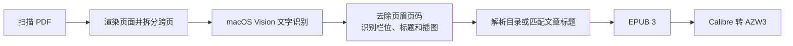

# scan2kindle

把**扫描版 PDF 书籍**转换成适合 Kindle 阅读的**可重排 EPUB** 和 **AZW3**。

[English](README.en.md)

很多扫描 PDF 只是一页页图片。直接放到 Kindle 上，字很小，也不能调字号。`scan2kindle` 会识别文字、重建段落和目录，并保留重要插图，让旧书、期刊和资料能在电子墨水屏上舒服阅读。

> 适用平台：macOS。文字识别使用 macOS 自带的 Vision 引擎，无需联网，也不会上传书籍内容。

## 让 AI 助手自动安装

如果你使用 Codex、Claude Code 或其他可以操作电脑的 AI 助手，可以复制下面整段内容并粘贴给它。它会检查环境、安装工具、创建 PDF 文件夹，并在你放好 PDF 后先试转、再批量转换。

> 这段说明只在你的 Mac 上处理文件，不会上传书籍。安装开发工具、Python 或 Calibre 时，可能需要你点击确认或输入电脑密码。

<details>
<summary><strong>展开并复制 AI 安装说明</strong></summary>

````text
请帮我在这台 Mac 上安装开源工具 scan2kindle，并带我完成第一次转换。

工具地址：https://github.com/beepony/scan2kindle

它可以把扫描版 PDF 转成适合 Kindle 阅读的 EPUB 和 AZW3。

请直接执行能自动完成的步骤，用简单清楚的中文告诉我进度。只有需要我点击确认、输入密码、放入 PDF，或安装方式需要我选择时，再停下来问我。

## 基本要求

- 这个工具目前只支持 macOS。如果不是 macOS，请停止并告诉我原因。
- 不要修改、移动、删除或上传我的原始 PDF。
- 只转换我有合法使用权的书籍。
- 不要上传任何 PDF、EPUB、AZW3 或识别出来的文字。
- 不要用 sudo，除非你先说明原因并得到我的同意。
- 如果命令因为权限、沙盒或网络限制失败，请按当前 AI 工具的规则申请权限后重试，不要绕过限制。
- 不要把工具安装到 PDF 所在的文件夹里。

## 1. 检查电脑环境

1. 确认系统是 macOS。
2. 检查 git 和 swiftc 是否可用：
   - 如果不可用，运行 `xcode-select --install`。
   - 告诉我在弹出的窗口里点击“安装”。
   - 等我说安装完成后再继续。
3. 找到 Python 3.10 或更新版本：
   - 注意：macOS 自带的 python3 可能只有 3.9，不能用。
   - 如果没有合适版本，但电脑已经安装 Homebrew，可以运行 `brew install python@3.12`。
   - 如果没有 Homebrew，先向我说明有哪些安装方式，再继续。
4. 检查 Calibre 的 ebook-convert：
   - 可以在 PATH 中查找，或检查 `/Applications/calibre.app/Contents/MacOS/ebook-convert`。
   - 如果没有，但已安装 Homebrew，可以运行 `brew install --cask calibre`。
   - 如果无法安装，可以先只生成 EPUB；AZW3 需要 Calibre。

## 2. 安装 scan2kindle

1. 如果 `~/scan2kindle` 不存在，就从 GitHub 下载工具：

```zsh
git clone https://github.com/beepony/scan2kindle.git ~/scan2kindle
```

2. 如果 `~/scan2kindle` 已经存在，并且确实是这个仓库，就运行 `git pull --ff-only` 更新。如果它不是这个仓库，先问我怎么处理。
3. 创建独立的 Python 环境。把下面的 `<Python 3.10+ 路径>` 换成刚才找到的 Python：

```zsh
cd ~/scan2kindle
<Python 3.10+ 路径> -m venv .venv
.venv/bin/python -m pip install --upgrade pip
.venv/bin/python -m pip install -e '.[test]'
```

4. 安装后检查：

```zsh
.venv/bin/scan2kindle --version
.venv/bin/python -m pytest -q
```

## 3. 准备工作文件夹

创建这些文件夹：

```zsh
mkdir -p "$HOME/Kindle转换/待转换PDF"
mkdir -p "$HOME/Kindle转换/输出"
mkdir -p "$HOME/Kindle转换/试转换"
```

然后用访达打开 `$HOME/Kindle转换/待转换PDF`。

请这样告诉我：

- 把要转换的扫描 PDF 放进“待转换PDF”文件夹。
- 可以建立子文件夹，例如“2024年”“历史书”；输出时会保留同样的结构。
- 如果原 PDF 很重要，建议复制进去，原文件另外保留。
- 放好后回复“已放好”。

收到我的“已放好”后再继续。

## 4. 先试转一本

1. 找出“待转换PDF”文件夹及其子文件夹里的所有 PDF，告诉我数量和总大小。
2. 选择第一本 PDF，只转换前 30 页，结果放在“试转换”文件夹，避免影响正式结果。
3. 如果已安装 Calibre，运行：

```zsh
cd ~/scan2kindle
.venv/bin/scan2kindle "<第一本 PDF 的完整路径>" -o "$HOME/Kindle转换/试转换" --pages 1-30 --azw3 --force
```

4. 如果没有安装 Calibre，去掉 `--azw3`。
5. 第一次运行会编译 macOS 文字识别程序。如果出现 `Foundation._GenericObjCError` 或类似错误，通常是当前 AI 工具的限制导致的。请申请在当前限制之外运行后重试。
6. 试转成功后告诉我：
   - EPUB 和 AZW3 的位置；
   - 识别出多少字；
   - 生成了多少个目录项；
   - 有没有明显异常。
7. 如果电脑里有 epubcheck，也请检查试转换得到的 EPUB。

## 5. 开始批量转换

试转成功后，开始批量转换。转换时防止 Mac 休眠：

```zsh
cd ~/scan2kindle
caffeinate -dimsu .venv/bin/scan2kindle "$HOME/Kindle转换/待转换PDF" -o "$HOME/Kindle转换/输出" --azw3 2>&1 | tee -a "$HOME/Kindle转换/输出/转换日志.txt"
```

如果没有安装 Calibre，去掉 `--azw3`。

转换过程中：

- 每隔一段时间告诉我完成了几本，不要刷屏显示完整日志。
- 如果中断，请再次运行同一条命令。已经完成的书会自动跳过，已识别的页面也会继续使用。
- 除非我要求重新生成，否则不要使用 `--force`。

## 6. 转换完成后

1. 查看 `$HOME/Kindle转换/输出/conversion-report.csv`，告诉我：
   - 成功、跳过和失败的数量；
   - 字数明显偏少的书；
   - 目录项很少的书；
   - 识别可信度较低的书。
2. 如果可以，用 epubcheck 检查所有 EPUB。
3. 用访达打开 `$HOME/Kindle转换/输出`。
4. 用简单的话告诉我：
   - EPUB 在“输出/EPUB”，适合用 Send to Kindle 发送；
   - AZW3 在“输出/AZW3”，适合用数据线复制到 Kindle 的 documents 文件夹；
   - 以后新增 PDF 时，只要放进“待转换PDF”文件夹，再让你运行同样的批量转换命令即可。

最后请提醒我：扫描识别仍可能有少量错字，复杂表格、公式、竖排文字和特殊版面可能保留为图片。请先在 Kindle 上抽查几本，再决定是否删除原 PDF。
````

</details>

也可以直接查看或下载：[prompts/agent-install.zh-CN.md](prompts/agent-install.zh-CN.md)

## 功能

- 批量处理一个文件夹中的所有 PDF，并保留子文件夹结构。
- 使用 macOS Vision 离线识别简体中文和英文，也可以指定其他语言。
- 自动拆分左右两页扫描在同一个 PDF 页面上的“跨页”。
- 去除页眉、页码，识别单栏/双栏，合并跨行和跨页段落。
- 识别大字号标题、作者、图片和图片说明。
- 从扫描目录页生成 Kindle 可跳转目录。
- 目录页没有页码或书中没有目录页时，会匹配文章首页的大标题。
- 保留封面、目录页和图片较多的页面图像，避免版面信息丢失。
- 输出标准 EPUB 3；安装 Calibre 后可同时输出 AZW3。
- 缓存页面图像和识别结果，中断后可继续，已完成的书会自动跳过。
- 自动跳过内容完全相同的重复 PDF，并生成 CSV 转换报告。

## 工作流程



更详细的处理步骤见 [docs/workflow.zh-CN.md](docs/workflow.zh-CN.md)。

## 安装

需要：

- macOS 13 或更新版本
- Python 3.10 或更新版本
- Xcode Command Line Tools，用于首次运行时编译 Vision 识别程序
- 可选：[Calibre](https://calibre-ebook.com/)，用于生成 AZW3
- 可选：[EPUBCheck](https://www.w3.org/publishing/epubcheck/)，用于检查 EPUB 格式

```zsh
xcode-select --install
brew install --cask calibre      # 需要 AZW3 时安装
git clone https://github.com/beepony/scan2kindle.git
cd scan2kindle
python3 -m venv .venv
.venv/bin/python -m pip install -e .
```

## 使用

转换一个文件夹，同时输出 EPUB 和 AZW3：

```zsh
.venv/bin/scan2kindle ~/Books/scans -o ~/Books/kindle --azw3
```

只转换一个 PDF：

```zsh
.venv/bin/scan2kindle ~/Books/scans/book.pdf -o ~/Books/kindle --azw3
```

只先试转前 30 页：

```zsh
.venv/bin/scan2kindle ~/Books/scans/book.pdf -o /tmp/s2k-test --pages 1-30
```

也可以双击 `scripts/convert-folder.command`，选择 PDF 所在文件夹。首次运行会自动安装依赖。

### 常用参数

| 参数 | 说明 |
| --- | --- |
| `--azw3` | 同时生成 AZW3，需要 Calibre |
| `--force` | 覆盖已经生成的 EPUB/AZW3 |
| `--languages zh-Hans,en-US` | 文字识别语言，例如 `zh-Hant,en-US` 或 `ja-JP,en-US` |
| `--book-language zh-CN` | 写入电子书的语言标签 |
| `--author "作者名"` | 为本批所有书写入作者信息 |
| `--no-split-spreads` | 不拆分较宽的扫描页 |
| `--page-height 2200` | 识别前渲染的页面高度，数值越大越清晰但越慢 |
| `--ocr-jobs 4` | 同时进行文字识别的任务数 |

运行 `.venv/bin/scan2kindle --help` 查看全部参数。

## 输出

```text
kindle/
├── EPUB/                 # 适合 Send to Kindle、Apple Books 等
├── AZW3/                 # 适合 USB 复制到 Kindle 的 documents 文件夹
├── conversion-report.csv # 页数、字数、目录数和识别质量统计
└── .cache/               # 页面图像与识别缓存，可用于断点续跑
```

传到 Kindle：

- 用 Send to Kindle 发送 `EPUB/` 中的文件。
- 或用 USB 连接 Kindle，把 `AZW3/` 中的文件复制到 Kindle 的 `documents` 文件夹。

确认结果满意后，可以删除 `.cache/` 释放空间；保留它则可在调整规则后快速重建电子书，无需重新识别。

## 实测

该流程最初用于一批中文扫描期刊：121 个 PDF、约 4.7 GB，包含单页扫描、双页跨页扫描、单栏/双栏、插图和不同年代的目录格式。

在 Apple Silicon Mac 上，文字识别约为每页 0.9 秒，一本约 320 页的书通常需要 0.7–0.8 分钟。生成的 EPUB 均通过 EPUBCheck 检查。

## 已知限制

- 识别结果仍可能有少量错字、断段错误或图片说明位置不准确。
- 复杂表格、公式、竖排文字和特殊排版通常保留为图片，不能完全还原。
- 目录识别依赖版面规律；没有清晰目录或标题的书，可能只能生成较粗的章节。
- 目前仅支持 macOS。Vision 在部分沙盒或受限环境中可能无法运行。

## 版权提醒

本项目只提供格式转换工具，不包含任何书籍内容。请仅转换你拥有合法使用权的文件，并遵守所在地区的版权法律。不要上传或分享受版权保护的 PDF、EPUB 或 AZW3 文件。

## 开发

```zsh
.venv/bin/python -m pip install -e '.[test]'
.venv/bin/python -m pytest
```

欢迎提交问题和改进。请不要在 issue 或测试数据中上传受版权保护的扫描页。

## 许可证

[MIT](LICENSE)
