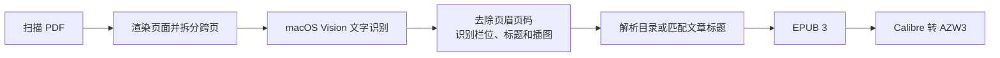

# scan2kindle

把**扫描版 PDF 书籍**转换成适合 Kindle 阅读的**可重排 EPUB** 和 **AZW3**。

[English](README.en.md)

很多扫描 PDF 只是一页页图片。直接放到 Kindle 上，字很小，也不能调字号。`scan2kindle` 会识别文字、重建段落和目录，并保留重要插图，让旧书、期刊和资料能在电子墨水屏上舒服阅读。

> 适用平台：macOS。文字识别使用 macOS 自带的 Vision 引擎，无需联网，也不会上传书籍内容。

## 功能

- 批量处理一个文件夹中的所有 PDF，并保留子文件夹结构。
- 使用 macOS Vision 离线识别简体中文和英文，也可以指定其他语言。
- 自动拆分左右两页扫描在同一个 PDF 页面上的“跨页”。
- 去除页眉、页码，识别单栏/双栏，合并跨行和跨页段落。
- 识别大字号标题、作者、图片和图片说明。
- 从扫描目录页生成 Kindle 可跳转目录。
- 目录页没有页码或书中没有目录页时，会匹配文章首页的大标题。
- 保留封面、目录页和图片较多的页面图像，避免版面信息丢失。
- 输出标准 EPUB 3；安装 Calibre 后可同时输出 AZW3。
- 缓存页面图像和识别结果，中断后可继续，已完成的书会自动跳过。
- 自动跳过内容完全相同的重复 PDF，并生成 CSV 转换报告。

## 工作流程



更详细的处理步骤见 [docs/workflow.zh-CN.md](docs/workflow.zh-CN.md)。

## 安装

需要：

- macOS 13 或更新版本
- Python 3.10 或更新版本
- Xcode Command Line Tools，用于首次运行时编译 Vision 识别程序
- 可选：[Calibre](https://calibre-ebook.com/)，用于生成 AZW3
- 可选：[EPUBCheck](https://www.w3.org/publishing/epubcheck/)，用于检查 EPUB 格式

```zsh
xcode-select --install
brew install --cask calibre      # 需要 AZW3 时安装
git clone https://github.com/beepony/scan2kindle.git
cd scan2kindle
python3 -m venv .venv
.venv/bin/python -m pip install -e .
```

## 使用

转换一个文件夹，同时输出 EPUB 和 AZW3：

```zsh
.venv/bin/scan2kindle ~/Books/scans -o ~/Books/kindle --azw3
```

只转换一个 PDF：

```zsh
.venv/bin/scan2kindle ~/Books/scans/book.pdf -o ~/Books/kindle --azw3
```

只先试转前 30 页：

```zsh
.venv/bin/scan2kindle ~/Books/scans/book.pdf -o /tmp/s2k-test --pages 1-30
```

也可以双击 `scripts/convert-folder.command`，选择 PDF 所在文件夹。首次运行会自动安装依赖。

### 常用参数

| 参数 | 说明 |
| --- | --- |
| `--azw3` | 同时生成 AZW3，需要 Calibre |
| `--force` | 覆盖已经生成的 EPUB/AZW3 |
| `--languages zh-Hans,en-US` | 文字识别语言，例如 `zh-Hant,en-US` 或 `ja-JP,en-US` |
| `--book-language zh-CN` | 写入电子书的语言标签 |
| `--author "作者名"` | 为本批所有书写入作者信息 |
| `--no-split-spreads` | 不拆分较宽的扫描页 |
| `--page-height 2200` | 识别前渲染的页面高度，数值越大越清晰但越慢 |
| `--ocr-jobs 4` | 同时进行文字识别的任务数 |

运行 `.venv/bin/scan2kindle --help` 查看全部参数。

## 输出

```text
kindle/
├── EPUB/                 # 适合 Send to Kindle、Apple Books 等
├── AZW3/                 # 适合 USB 复制到 Kindle 的 documents 文件夹
├── conversion-report.csv # 页数、字数、目录数和识别质量统计
└── .cache/               # 页面图像与识别缓存，可用于断点续跑
```

传到 Kindle：

- 用 Send to Kindle 发送 `EPUB/` 中的文件。
- 或用 USB 连接 Kindle，把 `AZW3/` 中的文件复制到 Kindle 的 `documents` 文件夹。

确认结果满意后，可以删除 `.cache/` 释放空间；保留它则可在调整规则后快速重建电子书，无需重新识别。

## 实测

该流程最初用于一批中文扫描期刊：121 个 PDF、约 4.7 GB，包含单页扫描、双页跨页扫描、单栏/双栏、插图和不同年代的目录格式。

在 Apple Silicon Mac 上，文字识别约为每页 0.9 秒，一本约 320 页的书通常需要 0.7–0.8 分钟。生成的 EPUB 均通过 EPUBCheck 检查。

## 已知限制

- 识别结果仍可能有少量错字、断段错误或图片说明位置不准确。
- 复杂表格、公式、竖排文字和特殊排版通常保留为图片，不能完全还原。
- 目录识别依赖版面规律；没有清晰目录或标题的书，可能只能生成较粗的章节。
- 目前仅支持 macOS。Vision 在部分沙盒或受限环境中可能无法运行。

## 版权提醒

本项目只提供格式转换工具，不包含任何书籍内容。请仅转换你拥有合法使用权的文件，并遵守所在地区的版权法律。不要上传或分享受版权保护的 PDF、EPUB 或 AZW3 文件。

## 开发

```zsh
.venv/bin/python -m pip install -e '.[test]'
.venv/bin/python -m pytest
```

欢迎提交问题和改进。请不要在 issue 或测试数据中上传受版权保护的扫描页。

## 许可证

[MIT](LICENSE)
